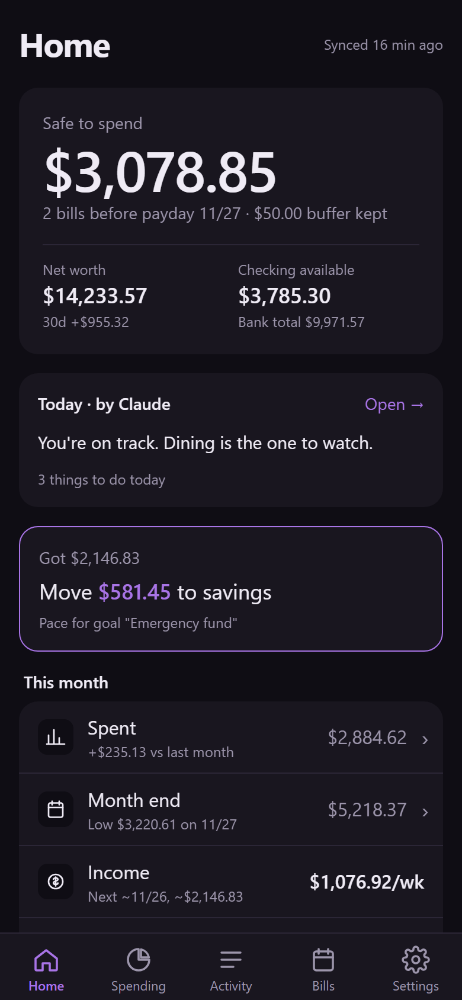
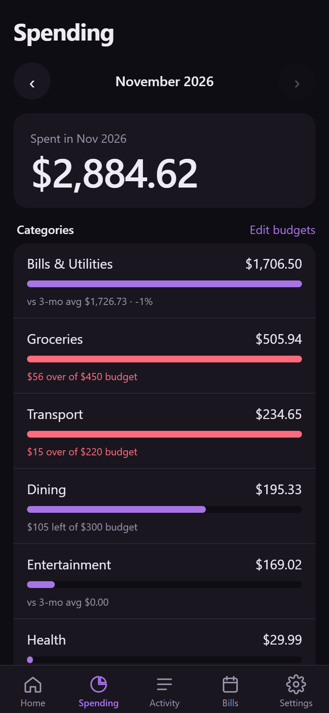
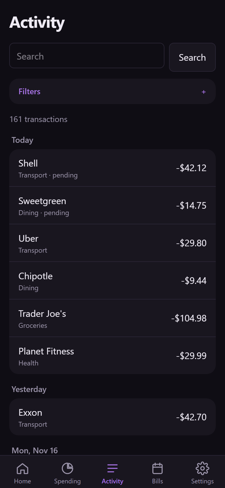
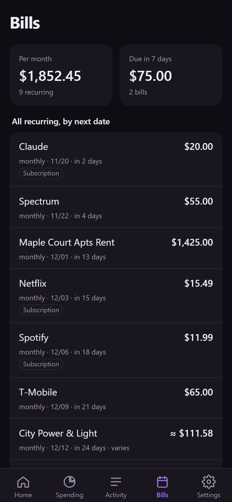

# ownbank

Your bank account, on your own server, inside Claude.

| | | | |
| --- | --- | --- | --- |
|  |  |  |  |

ownbank is a private finance app for one person. It pulls your bank transactions onto a server you control, sorts them, and shows them in a phone-friendly web app. It also speaks MCP, so Claude can answer "can I afford this?" from your real numbers.

## What it does

- Imports checking and savings transactions and categorizes them with rules you can edit.
- Shows safe to spend, month-end forecast, spending by category, bills and subscriptions, and net worth.
- Budgets with alerts, and a savings goal with milestones.
- Optional Solana wallet balances (savings and trading wallets).
- Push alerts to your phone (Web Push or ntfy) and a daily digest.
- An MCP server for Claude, read-only by default.

## How it works

1. [SimpleFIN](https://beta-bridge.simplefin.org) gives a read-only bank feed. It costs about $15 a year and cannot move money.
2. ownbank syncs it every two hours into a SQLite file on your server.
3. The web app and the MCP server read that file. Nothing is sent to a third party except the bank feed request itself.

## Quick start (Docker)

```sh
git clone https://github.com/opsec-bot/ownbank-oss.git && cd ownbank-oss
cp .env.example .env
docker compose up -d --build
docker compose logs ownbank
```

The log prints a line like `ownbank setup code: ABCD-EFGH-JKLM`. Open http://localhost:3000/setup, enter the code, pick an email and a password (12 characters or more), then follow Settings > Bank to connect SimpleFIN.

Not on localhost? Set `APP_URL` in `.env` to your public https address before you start. See [INSTALL.md](INSTALL.md) for HTTPS, Fly.io and local development.

## Install with an AI agent

Paste this into Claude Code, Codex or a similar agent:

```text
Install ownbank from https://github.com/opsec-bot/ownbank-oss on this machine.
Follow INSTALL.md exactly. Ask me for anything it says to ask the human for.
Run `npm run doctor -- --json` at the end and show me the result.
```

## Connect Claude

- claude.ai: add a custom connector with the URL `<APP_URL>/api/mcp`. Sign in when asked. Approve the scopes you want.
- Claude Code:

```sh
claude mcp add --transport http ownbank <APP_URL>/api/mcp --header "Authorization: Bearer <MCP_TOKEN>"
```

`MCP_TOKEN` is generated on first start. Read it from `data/secrets.json`, or set your own in `.env`.

Tools are read-only unless you set `MCP_WRITE_ENABLED=true`. The one narrow exception is `publish_digest`, which lets Claude post your morning digest.

## Daily digest

A scheduled Claude routine can write a short digest each morning and push it to your phone. The prompt and setup are in [docs/digest-routine.md](docs/digest-routine.md). Without it, the app writes a plain numbers-only digest itself at 8:15 AM.

## Security model

- One owner. There is no signup. The owner is created once, with a one-time setup code from the server log.
- The bank feed is read-only. ownbank cannot move money.
- The bank access token is encrypted (AES-256-GCM) before it is stored.
- Passwords use argon2id. Logins are rate limited. TOTP two-factor is optional (Settings > Security).
- MCP is read-only by default. OAuth tokens are stored hashed.
- Back up `data/` including `secrets.json`. Without the encryption key a restored database cannot read the bank token, and you would reconnect the bank.

Report problems as described in [SECURITY.md](SECURITY.md).

## Configuration

Everything is optional. Secrets are generated on first start and stored in `secrets.json` next to the database. Anything you set in the environment wins.

| Variable | Default | What it does |
| --- | --- | --- |
| `APP_URL` | `http://localhost:3000` | Public address (cookies, OAuth, push links). Set it when not on localhost |
| `APP_TIMEZONE` | `America/Chicago` | IANA timezone for dates, quiet hours and digests |
| `HELIUS_RPC_URL` | off | Turns on Solana wallet balances. Free key at dashboard.helius.dev |
| `NTFY_TOPIC`, `NTFY_URL`, `NTFY_TOKEN` | off | Phone alerts through ntfy |
| `BUCKET_NAME`, `AWS_*` | off | Litestream backups to an S3 compatible bucket |
| `MCP_WRITE_ENABLED` | `false` | Let Claude change data over MCP |
| `MCP_DIGEST_ENABLED` | on | Set `0` to stop Claude posting digests |
| `DISABLE_SYNC_TIMER`, `DISABLE_SCHEDULER` | unset | Set `1` to stop background sync or the notification scheduler |
| `TOKEN_ENC_KEY`, `SYNC_SECRET`, `MCP_TOKEN`, `VAPID_*` | generated | Your own values, if you manage secrets yourself |
| `DATABASE_PATH` | `./data/ownbank.db` | Database file. Docker uses `/data/ownbank.db` |

## Commands

| Command | What it does |
| --- | --- |
| `npm run doctor` | Checks your install. Add `-- --json` for machine output |
| `npm run seed:demo` | Builds `data/demo.db` with fake data to try the app without a bank. Run with `DATABASE_PATH=./data/demo.db` |
| `npm run create-owner` | Creates the owner from the terminal. `--email x --password-stdin` for scripts |
| `npm run create-owner -- --reset-password` | Changes the password and signs out every session. Add `--disable-2fa` to turn 2FA off |
| `npm run dev`, `npm run build`, `npm start` | Develop, build, run |
| `npm run typecheck`, `npm run lint`, `npm test` | Checks. `npm run test:integration` needs a build first |

Code layout: the schema is `src/lib/db/schema.ts`, money is stored as integer cents, and each folder in `src/lib` has a short README.

## Not financial advice

ownbank shows your own data and simple estimates. It is not financial, tax or legal advice. Check numbers against your bank before you act on them.

## License

[AGPL-3.0](LICENSE). If you run a modified version for other people, you must offer them the source.
